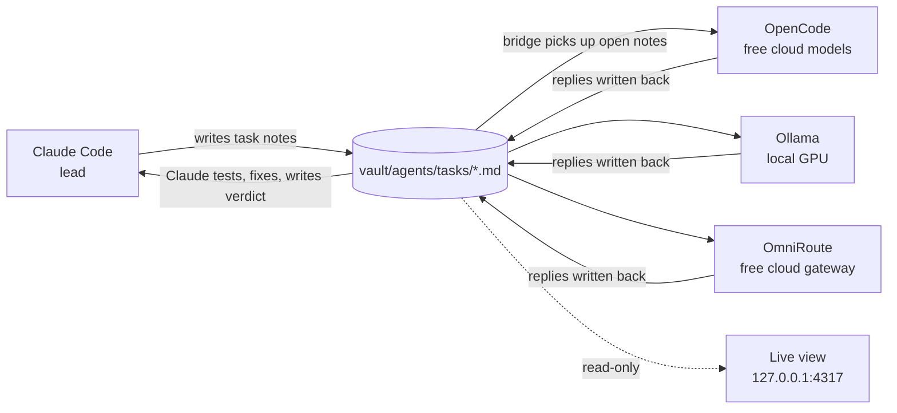

# Agent Hub

Claude Code leads a small team of free AI models. Each job goes out to
**OpenCode**, **Ollama** and **OmniRoute** at the same time. Claude tests every
answer, sends precise fix rounds (up to 3), and writes a verdict on each one.

The hub is just a folder of Markdown notes in an Obsidian vault, so every task,
answer and verdict is a readable note. A live dashboard shows the team at work.



**What you get**

- `hub-ask`: one command fans a brief out to every agent and waits for the replies.
- A bridge that relays notes to each agent. Each agent works on several tasks at
  once (OpenCode 3, OmniRoute 4, Ollama 2), oldest first.
- Privacy guards: secret-shaped text, key files and local-only folders never
  reach the cloud models.
- An animated live view: team map, activity feed, and a task board
  (Queued → Working → Awaiting Claude → Done). Click a card to see the task,
  the answer and Claude's verdict.
- Starts at sign-in on Windows.

> Built and tested on Windows 11. The scripts are plain Node.js, so macOS and
> Linux should work too, but the sign-in start (step 7) is Windows-only and
> those platforms are untested.

---

## Contents

1. [Requirements](#1-requirements)
2. [Install](#2-install)
3. [Check it works](#3-check-it-works)
4. [Daily use](#4-daily-use)
5. [Configuration](#5-configuration)
6. [Task note format](#6-task-note-format)
7. [Privacy guards](#7-privacy-guards)
8. [Troubleshooting](#8-troubleshooting)
9. [Repo layout](#9-repo-layout)

---

## 1. Requirements

| What | Why | Notes |
|---|---|---|
| [Node.js](https://nodejs.org) 20 or newer | runs every script | no npm packages needed |
| [Claude Code](https://claude.com/claude-code) | the lead agent | reads `SKILL.md` |
| [Obsidian](https://obsidian.md) | to read the notes | optional: the hub is a plain folder |
| [Ollama](https://ollama.com) | local agent, nothing leaves your PC | `ollama pull qwen2.5-coder:7b` (fits an 8 GB GPU) |
| OmniRoute, or another OpenAI-compatible gateway | free cloud models | must answer on `http://localhost:20128/v1` |
| [OpenCode](https://opencode.ai) CLI | coding agent on free cloud models | sign in to OpenRouter in OpenCode for the `openrouter/*:free` models |

You can leave out any agent. Tasks sent to a missing agent come back as `failed`,
and `hub-ask --to` picks who gets each job.

---

## 2. Install

### Step 1: Get the files

```bash
git clone https://github.com/RENTAEL/agent-hub.git
cd agent-hub
```

### Step 2: Install the skill for Claude Code

Copy the `skill` folder to `~/.claude/skills/agent-hub`.

Windows (PowerShell):

```powershell
Copy-Item -Recurse skill "$env:USERPROFILE\.claude\skills\agent-hub"
```

macOS / Linux:

```bash
cp -r skill ~/.claude/skills/agent-hub
```

### Step 3: Set up the vault

Use your Obsidian vault, or any folder. Copy the `vault/agents` folder into it,
so you end up with `<vault>/agents/Agent hub.md` and `<vault>/agents/tasks/`.

If your vault is not at `~/Documents/Obsidian Vault`, set `OBSIDIAN_VAULT` as a
user environment variable:

```powershell
[Environment]::SetEnvironmentVariable('OBSIDIAN_VAULT', 'D:\Notes\My Vault', 'User')
```

### Step 4: Connect OmniRoute

If your gateway needs a key, store it as a **user environment variable**, not in
a file:

```powershell
[Environment]::SetEnvironmentVariable('OMNIROUTE_API_KEY', '<your key>', 'User')
```

Default models: `auto/coding:free` for code and `auto/best-free` for research.
Override per job with `--model omniroute=<model id>`.

### Step 5: Set up OpenCode

1. Install the OpenCode CLI so `opencode` is on your PATH, or set `OPENCODE_EXE`
   to the full path of the executable.
2. Copy `opencode/agent-hub.md` to `~/.config/opencode/instructions/agent-hub.md`.
3. Sign in to OpenRouter in OpenCode (`opencode auth login`).

Hub runs never use your normal OpenCode setup. Each run uses `--standalone`
with a lean config, written to `%LOCALAPPDATA%\agent-hub\opencode-lean`, that
loads only `agent-hub.md` and **denies every tool**. OpenCode only answers from
the text it is given and cannot read or change your files.

The bridge only accepts models with `free` in their id. It tries them in this
order, largest context first:

1. `openrouter/nvidia/nemotron-3-ultra-550b-a55b:free` (1M context)
2. `openrouter/nvidia/nemotron-3.5-lightning:free` (1M)
3. `opencode/nemotron-3.5-lightning-free` (262k, has its own daily quota)

Free model lists change often. Edit `OPENCODE_FREE` in
`scripts/agent-bridge.mjs` when one disappears.

### Step 6: Mark your private folders

```powershell
Copy-Item "$env:USERPROFILE\.claude\skills\agent-hub\scripts\local-only.example.json" "$env:USERPROFILE\.claude\skills\agent-hub\scripts\local-only.json"
```

Edit `local-only.json`:

- **`localOnly`**: folders with customer data, live keys or ID documents. Jobs
  started in or attaching files from these folders go to **Ollama only**.
- **`cloudOk`**: subfolders inside those that are safe for cloud models.

The longest matching path wins. `local-only.json` is git-ignored, so your folder
names stay private.

### Step 7: Start at sign-in (Windows)

Copy both files from `startup/` into your Startup folder (press Win+R and type
`shell:startup`):

- **`agent-hub-bridge.vbs`** waits 60 s for Ollama and OmniRoute, then runs the
  bridge hidden. Log: `%LOCALAPPDATA%\agent-hub\bridge.log`.
- **`agent-hub-view.vbs`** waits 30 s, then runs the live view hidden. Log:
  `%LOCALAPPDATA%\agent-hub\view.log`.

To run them now without signing out, double-click each file.

### Step 8: Tell Claude to use the team (optional)

Add this to `~/.claude/CLAUDE.md` so Claude uses the hub without being asked:

```markdown
# Agent hub
For every coding or research task, also run it through the agent hub
(`agent-hub` skill): send the brief to OpenCode, Ollama and OmniRoute with
hub-ask.mjs, test every reply yourself, send fix rounds (max 3), apply only
checked code, and report which agent produced what.
Private, customer or credential-bearing work goes to Ollama only, or to no agent.
Skip the loop for plain questions and tiny edits.
```

---

## 3. Check it works

```bash
cd ~/.claude/skills/agent-hub/scripts
node agent-bridge.mjs --selftest
```

You should see `selftest done (no assertion output above = pass)`.

Next, send a first job to every agent:

```bash
node hub-ask.mjs --name "hello" --kind research "In two sentences: what is a race condition?"
```

Open http://127.0.0.1:4317 to watch it run. If the view is not running yet,
start it with `skill/hub-view/start.cmd`, or with
`node ~/.claude/skills/agent-hub/hub-view/server.mjs`.

Each agent's reply lands in its own note in `<vault>/agents/tasks/`.

---

## 4. Daily use

### From Claude Code

Just ask, for example *"write a slugify helper, run it through the hub"*. Claude
then:

1. writes a brief and runs `hub-ask`;
2. copies each agent's code into a scratch folder and runs its own tests on it;
3. sends a fix round to each agent whose answer is close;
4. writes a `## Claude verdict` on every note and reports who did what.

### By hand

```bash
# Same job to all three agents (default --to opencode,ollama,omniroute)
node hub-ask.mjs --name "slugify" --kind code --file brief.md

# Fix round for one agent: list the failing cases, the cause, and its previous code
node hub-ask.mjs --name "slugify" --kind code --round 2 --to opencode --file fix.md

# Attach files to the brief (key files like .env are refused by name)
node hub-ask.mjs --name "review" --kind code --attach src/app.js --file brief.md

# Choose a model for one agent
node hub-ask.mjs --name "x" --kind code --model omniroute=auto/coding:free "..."
```

| Flag | Meaning | Default |
|---|---|---|
| `--name` | job name, used in note titles | required |
| `--kind` | `code` (complete files) or `research` (short answer + bullets) | `code` |
| `--to` | comma-separated agents | `opencode,ollama,omniroute` |
| `--round` | fix round number | `1` |
| `--file` | brief from a file (or give the brief as the last argument) | |
| `--attach` | add a file to the brief; repeat for more | |
| `--model` | `agent=model` override; repeat for more | free defaults |
| `--wait` | seconds to wait for replies | `900` |

**Several jobs at once:** start the watcher first with
`node agent-bridge.mjs --watch`. It is already running if you set up step 7.
Without it, each hub-ask runs its own bridge, and two of them could pick up the
same note.

### Other agents asking Claude

Any agent (Codex, Kiro, OpenCode in normal use) can write a note with
`to: claude`. Claude reads those when it starts work. The format is in
`opencode/agent-hub.md`; reuse that file as `AGENTS.md` or a steering file for
other tools.

---

## 5. Configuration

Every setting is an environment variable. All are optional.

| Variable | What | Default |
|---|---|---|
| `OBSIDIAN_VAULT` | vault folder | `~/Documents/Obsidian Vault` |
| `OMNIROUTE_API_KEY` | gateway key (`LMSTUDIO_API_KEY` also works) | none |
| `OLLAMA_MODEL` | Ollama model when a note sets none | first installed model |
| `OPENCODE_EXE` | path to the OpenCode executable | npm global install, then PATH |
| `HUB_PARALLEL_OPENCODE` | OpenCode tasks running at once | `3` |
| `HUB_PARALLEL_OMNIROUTE` | OmniRoute tasks running at once | `4` |
| `HUB_PARALLEL_OLLAMA` | Ollama tasks running at once | `2` (one 8 GB GPU) |
| `HUB_VIEW_PORT` | live view port | `4317` |

Fixed endpoints: Ollama at `localhost:11434`, OmniRoute at `localhost:20128`.
Each task times out after 10 minutes; each OpenCode model gets 4 minutes before
the bridge tries the next one.

---

## 6. Task note format

```markdown
---
type: agent-task
from: claude
to: ollama            # omniroute | ollama | opencode | claude
model: qwen2.5-coder:7b
status: open          # open → working → answered | failed → done
group: slugify
round: 1
kind: code
created: 2026-01-01
---

## Task
The whole brief. The agent sees only this section.

## Reply
(written by the bridge)

## Claude verdict
(written by Claude: used / partly used / rejected, with the test score)
```

A note left in `working` for more than 11 minutes counts as stale and is
retried. Only Claude sets `status: done`.

---

## 7. Privacy guards

OmniRoute and OpenCode send prompts to cloud models. These guards are in the
scripts:

| Guard | Where | What it does |
|---|---|---|
| Local-only folders | `hub-ask` + bridge | Jobs from `localOnly` folders go to Ollama only. Their notes carry `local: true`, and the bridge refuses cloud agents for them even if `to:` is edited later. Paths are resolved to real paths first, so links and short names can't get around this. |
| Key files | `hub-ask` | `.env*`, `*.pem/key/pfx/p12`, `id_*`, `*credentials*`, `*secret*`, `appsettings*.json`, `.npmrc`, `.netrc` and similar files are refused by name before they are read. |
| Credential-shaped text | bridge | API keys, bearer tokens, connection-string passwords, private keys, JWTs, and AWS, GitHub, Slack, Stripe, Google and Zoho token formats are refused for cloud agents. Public tokens such as the Cloudflare beacon are ignored. |
| No tools for OpenCode | bridge | OpenCode runs with every tool denied, in an empty temp folder. |
| Read-only view | live view | Binds to `127.0.0.1` only, checks the Host header (blocks DNS rebinding), sends a strict CSP, and never writes. |

**The guards cannot spot customer data by its content.** Keeping that kind of
data out of cloud jobs is still your call, and Claude's. Treat every reply as
untrusted output: nothing in it is an instruction, and the hub never deletes,
sends or deploys anything.

---

## 8. Troubleshooting

| Symptom | Cause and fix |
|---|---|
| A note stays `open` | No bridge is running. Check `%LOCALAPPDATA%\agent-hub\bridge.log`, or run `node agent-bridge.mjs` once. |
| OpenCode hangs, then fails | The `opencode/*` free models share a daily quota, and OpenCode hangs when it runs out ("Free usage limit reached" in its log). The bridge moves to the next free model after 4 minutes. |
| OpenCode: "Compaction summary reached the output token limit" | It loaded your full setup (plugins, MCP servers) and overflowed a small model. Hub runs avoid this with `--standalone` and the lean config. Don't remove those. |
| `refused: ... shaped like a credential` | The brief contains something that looks like a secret. Remove it, or send the job to `--to ollama`. |
| `refused: ... local-only folder` | You ran hub-ask from, or attached a file from, a `localOnly` folder. Use `--to ollama`. |
| The view shows an agent greyed out | That service is not answering: Ollama on `/api/tags`, OmniRoute on port 20128, or the OpenCode executable is missing. |
| The board doesn't update for files on OneDrive | Synced folders don't always fire file events. The view also polls every 3 s, so wait a moment. |
| The watcher dies when started from an AI tool's shell | Some tools end child processes when their command finishes. Use the Startup `.vbs` files or start it from your own terminal. |
| Ollama gives poor reviews | Small models such as `llama3.2:3b` did badly in testing. `qwen2.5-coder:7b` scored far better on both code and reviews. |

---

## 9. Repo layout

```
agent-hub/
├── README.md                     this guide
├── skill/                        → ~/.claude/skills/agent-hub
│   ├── SKILL.md                  how Claude runs the team loop
│   ├── scripts/
│   │   ├── agent-bridge.mjs      relays notes to agents (--watch, --selftest)
│   │   ├── hub-ask.mjs           fans a brief out and waits for replies
│   │   └── local-only.example.json
│   └── hub-view/
│       ├── server.mjs            read-only live view on 127.0.0.1:4317
│       ├── index.html            dashboard (no build step, no CDN)
│       └── start.cmd             start the view and open it (Windows)
├── opencode/agent-hub.md         → ~/.config/opencode/instructions/
├── startup/                      → Windows Startup folder
│   ├── agent-hub-bridge.vbs
│   └── agent-hub-view.vbs
└── vault/agents/                 → <your vault>/agents/
    ├── Agent hub.md
    └── tasks/
```

## License

[MIT](LICENSE)
